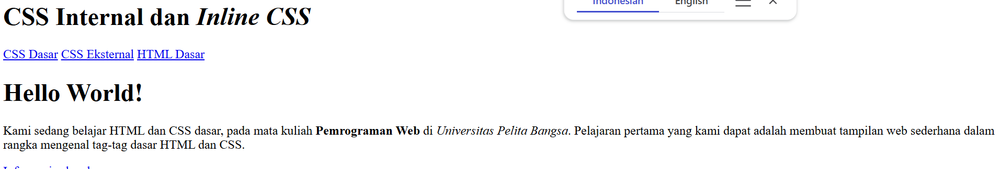
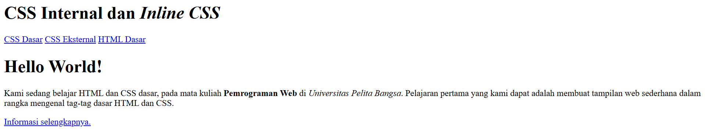
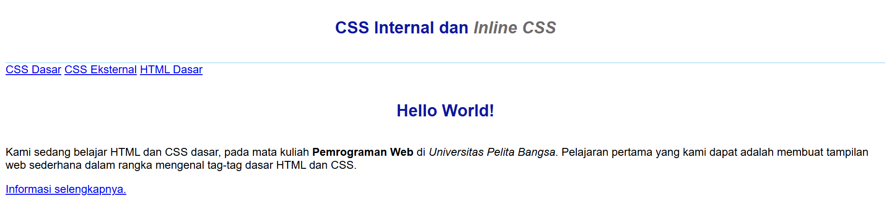
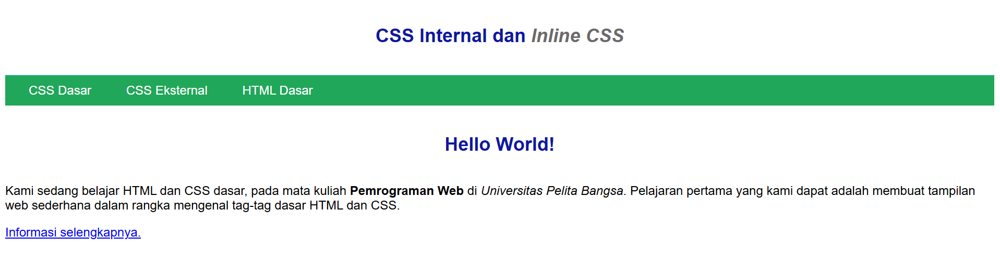
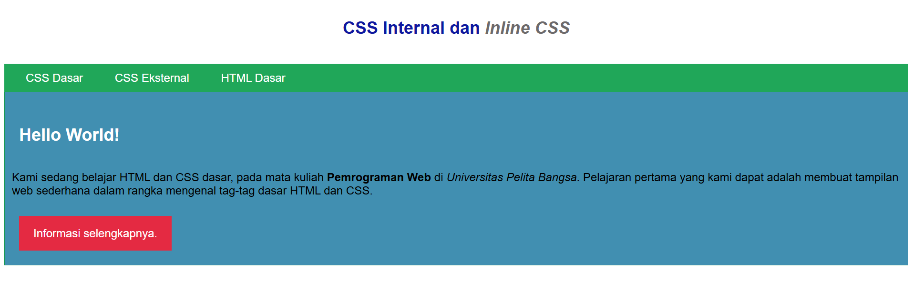

# Lab3Web

Praktikum Pemrograman Web & CSS Dasar

## 1. CSS Internal dan Inline CSS

**Penjelasan:** Mempelajari penggunaan CSS internal dan inline untuk mengatur tampilan halaman HTML, seperti mengubah warna teks, ukuran huruf, dan tata letak halaman.

### Dokumentasi

**Screenshot 1 – CSS Internal dan Inline CSS**

## 2. CSS Eksternal

**Penjelasan:** Menggunakan file `style_eksternal.css` untuk mengatur tampilan halaman web, termasuk navigasi, warna latar belakang, dan tombol informasi.

### Dokumentasi

**Screenshot 4 – CSS Eksternal**

**Screenshot 5 – Hasil Akhir CSS Eksternal**

